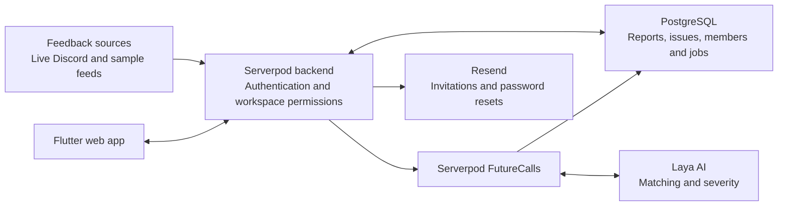

# Feedback Aggregator AI

**Many conversations. One clear next action.**

Feedback Aggregator AI helps developers and product managers turn scattered user feedback into grouped, prioritized issues. Teams can understand how often a problem occurs, see the original reports, and track its resolution together.

[Open the app](https://feedbackaggregatorai.online) · [Deployed source branch](https://github.com/shekokarmahesh/Feedback-Aggregator-App/tree/add-postbot-mascot)

> The deployed application currently runs from `add-postbot-mascot`. Use that branch for the features and setup described below; `main` does not yet contain all of the deployed implementation.

## What the app does

- **Unified inbox:** Search, filter, and sort feedback by platform, status, priority, and priority score.
- **AI grouping:** Laya analyzes titles and message bodies, grouping matching reports into one persistent issue while preserving the original evidence and sources.
- **Human review:** Uncertain matches remain separate and appear as **Needs review**.
- **Prioritization:** A 0–100 score combines report frequency, platform reach, and estimated severity.
- **Shared progress:** Updating an issue's status keeps its grouped reports aligned.
- **Organization workspaces:** Switch between isolated workspaces and invite teammates by email or share link.
- **Access control:** Admins manage members, invitations, sources, and feedback; Editors add, update, and sync feedback; Viewers have read-only access.
- **Authentication:** Serverpod email/password and Google sign-in, session restoration, sign-out, and Resend password-reset emails.
- **Source lifecycle:** Connections persist, synchronization avoids duplicate imports, and disconnect removes that platform's reports and contributions from the visible inbox. Reconnect restores existing records and statuses.

## Flutter and Serverpod

| Component | Responsibility |
| --- | --- |
| **Flutter** | Responsive web interface: landing page, authentication, workspaces, sources, feedback inbox, issue details, and account profile. |
| **Serverpod** | Typed APIs and generated Dart clients, built-in authentication, workspace membership and role checks, persistence, and background FutureCalls. |
| **PostgreSQL** | Stores accounts, workspace memberships, invitations, source connections, original reports, issue groups, and processing jobs. Serverpod manages the local database; production uses Render PostgreSQL. |
| **Laya AI** | Self-hosted inference for matching related reports and estimating severity. No OpenRouter API key is required. |
| **Resend** | Sends workspace invitations and password-reset codes. |
| **Render** | Hosts the application, PostgreSQL database, and Laya inference service. |

Local caching uses Serverpod's built-in process memory. Local development does not require Docker or Redis; production uses Docker deployment images.

## System architecture



Incoming workspace reports are saved before background processing begins. Laya evaluates candidate matches within the same workspace, and the resulting groups are persisted. The inbox refreshes automatically while open. Model failures retain the reports and retry; Admins and Editors can also request a retry.

The priority score combines up to **25 severity points**, **45 frequency points**, and **30 platform points**, using only reports from currently connected sources.

## Integration status

| Source | Current behavior | Sample feed size |
| --- | --- | --- |
| **Discord** | Live bot/guild integration and webhook submissions into workspace reports. | — |
| **Email** | Connect, sync, and disconnect with sample feedback. | 12 |
| **Slack** | Connect, sync, and disconnect with sample feedback. | 20 |
| **Forms** | Webhook configuration flow with sample feedback imports. | 8 |
| **Support** | Webhook configuration flow with sample feedback imports. | 15 |
| **App reviews** | Webhook configuration flow with sample feedback imports. | 9 |

The five sample feeds provide **64 reports** to exercise the complete import, grouping, prioritization, and team-status workflow. Initial connections import five reports, and synchronization imports the remaining reports in batches. In Forms, Support, and App reviews, **Use this key** fills the shared setup key before **Connect and import**.

The generic `POST /webhooks/feedback` endpoint requires a real team ingestion key and stores separate `Feedback` records. Bridging those generic records into workspace issue grouping is follow-up work. The shared setup key does not authorize real external webhook requests.

## Try the product

1. Sign in with Google or email/password and create a workspace.
2. Open **Sources**. Connect Email or Slack, or configure Forms, Support, and App reviews.
3. Return to **Inbox** to watch reports arrive and Laya process them in the background.
4. Open an issue to inspect its original reports, contributing platforms, and priority score.
5. Change its status and invite teammates through **Team**, assigning the appropriate access role.
6. Disconnect a source to remove its evidence from the inbox; reconnect to restore it without duplicate imports.

Grouping is asynchronous and can take several minutes on the hosted CPU service. The model can miss duplicates or flag ambiguous reports for review; it preserves the original evidence for the team.

## Run locally

Use the Dart SDK bundled with Flutter. The project uses **Serverpod 4.0.3** and requires **Dart 3.12.2 or newer**. Check your installed versions before changing SDKs.

```sh
git clone https://github.com/shekokarmahesh/Feedback-Aggregator-App.git
cd Feedback-Aggregator-App
git checkout add-postbot-mascot
cd feedback_aggregator
flutter pub get --enforce-lockfile
cd feedback_aggregator_server
python3 scripts/create_local_env.py
set -a
. ./.env
set +a
serverpod start
```

The environment script creates ignored local secrets without overwriting an existing setup. Serverpod starts the backend and configured Flutter app, manages PostgreSQL through `database.dataPath`, and applies committed migrations. Open `http://localhost:8082/`.

For Google sign-in, Resend delivery, and local Laya setup, follow the linked configuration guides below. Keep `.env`, `config/passwords.yaml`, provider API keys, and downloaded OAuth JSON out of Git. Email/password registration does not require an OTP; password resets use expiring, single-use codes delivered through Resend.

## Repository layout

```text
feedback_aggregator/
├── feedback_aggregator_flutter/   # Flutter frontend
├── feedback_aggregator_server/    # Serverpod backend and migrations
├── feedback_aggregator_client/    # Generated Dart client
└── tools/laya/                   # Laya inference service

deploy/                           # Production container startup and verification
Dockerfile                        # Application deployment image
```

## Development checks

With the server's local environment loaded:

```sh
# From feedback_aggregator/feedback_aggregator_server
dart analyze
dart test

# From feedback_aggregator/feedback_aggregator_flutter
dart analyze
flutter test --no-pub
```

Verification covers workspace isolation, permissions, source synchronization and disconnection, persistent grouping, authentication recovery, and the Flutter interface. Hosted grouping verification processed **65 reports into 45 issues**, preserving all original reports and flagging uncertain matches for review; this is an observed test result, not an accuracy guarantee.

## Setup and implementation guides

- [Collaborator and environment setup](feedback_aggregator/COLLABORATOR_SETUP.md)
- [Workspaces, invitations, and permissions](feedback_aggregator/WORKSPACES.md)
- [Google authentication](feedback_aggregator/GOOGLE_AUTH_SETUP.md)
- [Email and password-reset delivery](feedback_aggregator/EMAIL_AUTH_SETUP.md)
- [Database and caching](feedback_aggregator/STORAGE_RESEARCH.md)
- [Webhook ingestion](feedback_aggregator/FEEDBACK_WEBHOOK_SETUP.md)
- [Source integrations and automatic grouping](https://github.com/shekokarmahesh/Feedback-Aggregator-App/blob/add-postbot-mascot/feedback_aggregator/MOCK_SOURCES.md)
- [Render deployment](https://github.com/shekokarmahesh/Feedback-Aggregator-App/blob/add-postbot-mascot/RENDER_DEPLOYMENT.md)
