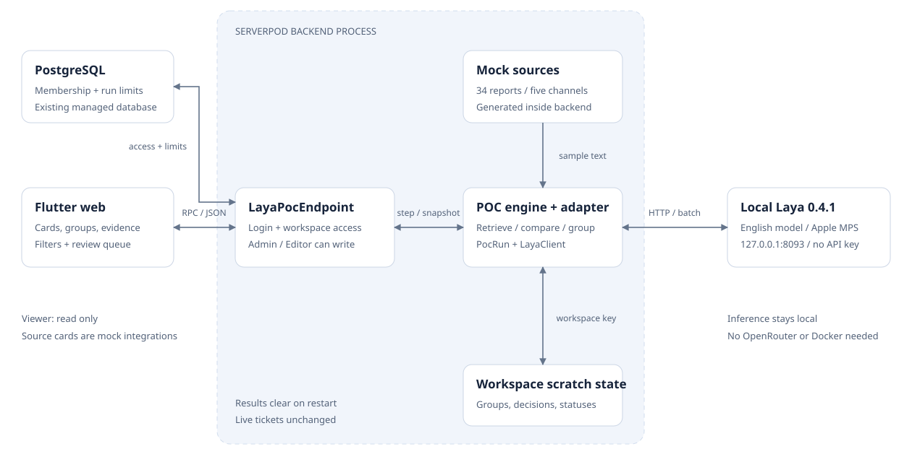
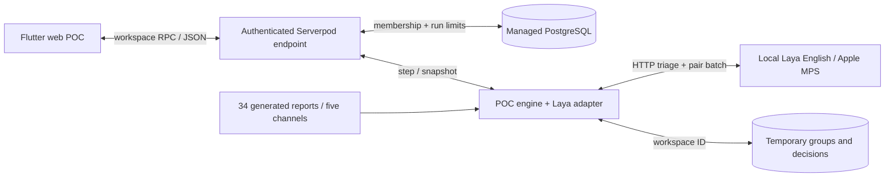

# Laya feedback aggregation POC

## Retest report · 9 October 2026

**Verdict: the local integration works, but clustering quality is insufficient for automatic use.** The POC can run without a paid API key. It preserves evidence and produces a priority-ranked team view, but misses too many repeated reports with the current Laya model and prompts.

## What we tested

We froze the existing model, prompts, retrieval logic, and thresholds. Four real-inference runs used the same 34 synthetic English reports: six product issues paraphrased across Discord, Slack, Email, Forms, and Support, plus two chatter messages and two vague complaints. The 30 concrete reports contain **60 expected duplicate pairs**: six groups × C(5,2). The two chatter messages have distinct labels; vague reports have no gold label.

Two ordered runs check repeatability. Shuffled arrival orders use Dart Random seeds 7 and 42. All four runs completed without inference errors. This is the existing development fixture, not an independent holdout. Gold labels were used only after decisions for scoring, never as model inputs.

## Measured results

| Run | Issues | Merges | Review | Precision | Recall | False pairs | Missed pairs | Request time |
| --- | --- | --- | --- | --- | --- | --- | --- | --- |
| ordered-1 | 10 | 5 | 19 | 83.3% | 8.3% | 1 | 55 | 19.936s |
| ordered-2 | 10 | 5 | 19 | 83.3% | 8.3% | 1 | 55 | 5.958s |
| shuffled-7 | 9 | 11 | 14 | 91.7% | 36.7% | 2 | 38 | 5.543s |
| shuffled-42 | 10 | 11 | 13 | 100.0% | 31.7% | 0 | 41 | 5.408s |

The ordered runs reproduced identical decisions, groups, scores, and metrics. Their request times differed. The original order recovered **5/60 true duplicate pairs**, with one incorrect pair; seed 7 recovered 22/60 with two incorrect pairs; seed 42 recovered 19/60 with zero incorrect pairs. The seed-42 precision is not a general claim of perfect accuracy.

API fees were **$0** in every run; inference consumes local machine resources. Durations sum model-adapter requests and exclude model download/startup, database/RPC overhead, and browser rendering. Machine load was not controlled, so these are observations rather than latency guarantees.

Pairwise precision = correct same-issue merged pairs / all merged pairs. Duplicate recall = recovered duplicate pairs / 60 expected duplicate pairs. Reviews, unmerged duplicates, and fragmented groups count as misses. Merge count means report-attachment events: a three-report group contributes three report pairs. Both chatter reports stayed in review in every run; neither was confidently removed as noise.

## Working system architecture





1. **Flutter web:** sample integration cards, source selection, grouped issues, search/status/channel filters, original reports, review queue, and priority scores. Flutter calls Serverpod, never the model directly.
2. **Serverpod API:** `read`, `start`, `step`, and `updateStatus` require login and workspace membership. Admin and Editor can run and update; Viewer can inspect. PostgreSQL supplies membership checks and the run-start rate limiter.
3. **Mock fixture:** generated by the backend. Discord, Slack, Email, Forms, and Support are labels, not connected accounts or inbound APIs. Source counts are 7/7/7/7/6 respectively.
4. **POC engine:** discovers issues from earlier accepted reports. It retrieves at most seven candidates using Jaccard word-set similarity and compares against each issue's first report.
5. **Local model service:** separate Python process on loopback HTTP. Triage calls `/v1/systemone`; candidate pairs call `/v1/systemone/batch`. No OpenRouter key or Docker dependency is needed on this Mac.
6. **Scratch state:** groups, evidence IDs, decisions, metrics, and statuses are kept in workspace-keyed bounded memory. They are shared inside that workspace and clear on backend restart. Grouped issues are not written into live feedback tickets. This is a single-instance POC, not durable distributed clustering.

## Decision workflow

1. Ask Laya to classify feedback as bug, feature, noise, or unclear and separately estimate severity from 0 to 4.
2. Bug/feature triage needs **answer confidence ≥0.60** before duplicate comparison. Unclear or low-confidence triage stays in review; confidently classified noise is excluded.
3. Compare the incoming message with up to seven issue exemplars. Each binary `noul` value is the probability that the pair describes the same specific issue. Values are independent; they do not sum to one.
4. Exactly one candidate at **≥0.80** is merged. Multiple qualifying candidates go to review. If every candidate is **≤0.50**, create a new issue. Intermediate matches go to review. With no candidates, confident actionable feedback starts the first issue.
5. Preserve original evidence, count linked reporter identities once, update priority, and return the snapshot. Issue titles come from their first reports; Laya does not generate prose summaries.

Choice/score gates use `answer_confidence`, not entropy-based `confidence`. Binary matching uses probability of true, not confidence in whichever binary answer won. Invalid model responses, token truncation, collapsed options, HTTP errors, and timeouts are rejected rather than replaced with fabricated groups. Failed reports remain retryable within the bounded attempt policy.

## Actual ordered output

| Issue | First-report title | Reports | People | Channels | Priority /100 | Report IDs | Gold check |
| --- | --- | --- | --- | --- | --- | --- | --- |
| POC-6 | Password recovery emails are missing | 3 | 3 | Slack, Forms, Support | 42 | SAMPLE-8, SAMPLE-20, SAMPLE-26 | Consistent with gold |
| POC-5 | Stuck in a loop after Google OAuth | 2 | 2 | Slack, Forms | 31 | SAMPLE-7, SAMPLE-19 | Consistent with gold |
| POC-7 | Our large workspace overview is painfully slow to load | 2 | 2 | Slack, Forms | 31 | SAMPLE-11, SAMPLE-23 | Consistent with gold |
| POC-1 | Google sign-in loops back to login | 1 | 1 | Discord | 26 | SAMPLE-1 | Consistent with gold |
| POC-3 | Filtered CSV downloads contain no rows | 2 | 2 | Discord, Forms | 26 | SAMPLE-4, SAMPLE-24 | Incorrect / mixed |
| POC-8 | First dashboard load takes around half a minute with 8,000 tickets; exports are fine | 1 | 1 | Email | 24 | SAMPLE-17 | Consistent with gold |
| POC-2 | Large CSV exports time out | 1 | 1 | Discord | 23 | SAMPLE-3 | Consistent with gold |
| POC-10 | CSV export for a large date range fails after a minute | 1 | 1 | Support | 22 | SAMPLE-27 | Consistent with gold |
| POC-4 | Add a dark theme | 1 | 1 | Discord | 18 | SAMPLE-6 | Consistent with gold |
| POC-9 | Downloaded CSV contains headers only when a source filter is active | 1 | 1 | Forms | 18 | SAMPLE-22 | Consistent with gold |

The top issue is **POC-6: password recovery emails missing**, with three reports from Slack, Forms, and Support, priority **42/100**. Its components are severity 23 + reach 9 + recent reports 4 + channel breadth 6. The sample identities are explicitly linked; real cross-platform identity resolution remains to be designed.

### Correct cross-channel merge

SAMPLE-20 (Forms): “Reset password cannot be completed because the email with the code is never delivered.” It joined POC-6, whose first message SAMPLE-8 (Slack) says: “Password recovery emails are missing. Tried resending the reset code three times.” Duplicate probability was **0.8817**. SAMPLE-26 (Support) also joined.

### Incorrect merge

SAMPLE-24 (Forms): “Please offer a dark appearance option for the dashboard.” It joined **POC-3, a filtered CSV with no rows**, at probability **0.8141**. These are different issues. This mistake recurred in both ordered runs and shuffled seed 7. It adds an unrelated person/channel to the issue and can distort priority.

### Missed duplicate

SAMPLE-9 (Slack), a large CSV timeout, matched POC-2 at **0.7833**, below the 0.80 policy threshold, and remained in review. The conservative gate avoids forcing a borderline match but loses recall.

### High-confidence review

SAMPLE-25, a Google-login redirect loop, scored **0.9709** against POC-5 and **0.8891** against POC-1. Both earlier groups already describe Google-login loops. The competing-match rule sent the report to review. The POC has no group-to-group merge to repair this fragmentation. A high confidence can therefore coexist with a review outcome.

## Priority scoring

`round(40 × severity / 4) + round(30 × min(unique people / 10, 1)) + round(20 × min(reports younger than 24h / 5, 1)) + round(10 × channel count / 5)`

Confidently critical severity (≥3.5 with severity answer confidence ≥0.80) receives a minimum priority of 95. Components are rounded. All ten ordered groups have severity flagged for review. Priority is a product rule, not a model accuracy metric; errors can affect ranking.

## Verification and limits

- **33 backend tests and 18 Flutter tests passed** during this retest. They verify software behavior, role/membership gates, evidence preservation, protocol handling, score rules, and UI flow. They do not establish model accuracy.
- **Live app check:** Not end-to-end verified. Serverpod and Flutter were running; Dart tooling could inspect the dashboard, but POC navigation was not confirmed. Native browser fallback was blocked by pending macOS Accessibility/Screen Recording permissions. The four model/engine runs completed independently.
- **Model:** Laya 0.4.1 / `english` / `convaiinnovations/laya`, revision `7b928d828b7b0e022f929d9bd2e44165aa270148`. Health reported Apple `mps`, zero CPU fallbacks.
- **Scope:** one synthetic English development fixture. No independent real-data, multilingual, adversarial, or large-volume evaluation was performed.
- **Order sensitivity:** demonstrated. Online grouping, lexical retrieval, first-report exemplars, and earlier fragmentation are plausible contributors; no ablation isolated their individual effects.
- **Missing product capabilities:** live connectors, durable cluster storage, manual reassignment/merge/split, and real identity resolution.
- **Bounds:** five starts per member/workspace/hour, at most twice the report count in attempts, at most 100 workspaces in scratch memory, and pruning of old idle runs.

## Verdict and next experiment

**Keep this as an experimental POC. Do not enable unattended customer-feedback grouping with this model/prompt combination.** The software path works, but original-order recall of 8.3% fails the main goal of consolidating repeated feedback. Even the better shuffled outputs miss 38–41 of 60 duplicate pairs.

Next, compare a stronger local semantic model and embedding-based retrieval on independently labeled realistic reports, add human merge/split/reassign controls, and tune thresholds on separate validation data. Evaluate multiple arrival orders. Suggested targets to agree with the team—not existing requirements—are ≥95% pair precision and ≥80% recall before automatic actions are considered.

## Reproduce and inspect

Start the existing model from the repository root: `cd feedback_aggregator && sh tools/laya/run.sh`.

Run the unchanged engine benchmark from `feedback_aggregator/feedback_aggregator_server`:

```sh
dart run tool/benchmark_laya.dart ../tools/laya/.runtime/benchmark.json
```

Inside this artifact folder, `dart run_evaluation.dart` repeats ordered/shuffled runs using byte-for-byte engine snapshots in `source/`. It requires the existing Dart SDK and unauthenticated loopback Laya service; it does not start Serverpod or touch its database. It overwrites ordered-2/shuffled captures, so copy the folder first to preserve this session.

`build_report.py` regenerates the report from saved evidence using Python with `markdown-it-py` (already available in `tools/laya/.venv`). Model-health and verification metadata describe this session and should be refreshed for a different setup.

Raw results: [ordered-1](ordered-1.json), [ordered-2](ordered-2.json), [shuffled-7](shuffled-7.json), [shuffled-42](shuffled-42.json). Also included: [model health](model-health.json), [verification](verification.json), and [source hashes](source-manifest.json). Gold labels in artifacts are for evaluation only, not model requests.

## Implementation evidence

The inspected implementation is an **uncommitted working-tree snapshot** over base commit `93bd29310c6bd797eb715751e946f09dcb96091e`. These are not claims about committed bytes at that ref. SHA-256 hashes pin the inspected files. Paths below are relative to `feedback_aggregator/`.

- `feedback_aggregator_flutter/lib/screens/laya_poc_panel.dart:12` — RPC calls; line 88 — run/resume flow.
- `feedback_aggregator_server/lib/src/laya_poc/laya_poc_endpoint.dart:11` — login and workspace-keyed scratch state; line 42 — role-gated start/rate limiter; line 105 — idempotent step.
- `feedback_aggregator_server/lib/src/workspaces/workspace_service.dart:53` — membership/role gate; line 66 — workspace/user-scoped membership lookup.
- `feedback_aggregator_server/lib/src/laya_poc/sample_feedback.dart:33` — fixed generated fixture.
- `feedback_aggregator_server/lib/src/laya_poc/poc_run.dart:76` — lexical retrieval; line 18 — priority; line 204 — post-decision pairwise metrics.
- `feedback_aggregator_server/lib/src/laya_poc/laya_client.dart:76` — triage and pair-batch HTTP; line 173 — response validation; line 238 — policy.
- `tools/laya/run.sh:10` — local model service and pinned weights.
